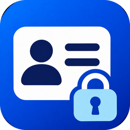

<p align="center">
  
</p>

<h1 align="center">Pocket Book</h1>

<p align="center">
  <b>Un gestionnaire de mots de passe hors ligne et un carnet d'adresses simples — on l'installe et on s'en sert tout de suite.</b><br>
  Windows · macOS · Linux — Français · English · Español · Deutsch · Italiano
</p>

<p align="center">
  <a href="https://github.com/MortalHammer92/Pocket-Book/actions/workflows/tests.yml"></a>
  <a href="https://github.com/MortalHammer92/Pocket-Book/releases/latest"></a>
  <a href="LICENSE"></a>
</p>

<p align="center">
  <a href="../../releases/latest">Télécharger</a> ·
  <a href="#installation">Installer</a> ·
  <a href="README.md">Read in English</a>
</p>

<p align="center">
  <a href="https://github.com/MortalHammer92/Pocket-Book/releases/latest/download/PocketBook-Setup-Windows.exe"></a>
  <a href="https://github.com/MortalHammer92/Pocket-Book/releases/latest/download/PocketBook-macOS-AppleSilicon.zip"></a>
  <a href="https://github.com/MortalHammer92/Pocket-Book/releases/latest/download/PocketBook-macOS-Intel.zip"></a>
  <a href="https://github.com/MortalHammer92/Pocket-Book/releases/latest/download/PocketBook-Linux.tar.gz"></a>
</p>

---

**Pocket Book** est un **gestionnaire de mots de passe hors ligne** et un **carnet d'adresses**
gratuits et open source pour **Windows, macOS et Linux**, pensés pour les **seniors et les
débutants** : gros caractères, grands boutons, sans compte, sans cloud, sans connexion internet.

## Pourquoi

Beaucoup de gens rangent leurs mots de passe et leurs contacts dans une pile de documents Word
ou de fichiers texte. Pocket Book a d'abord été fait pour une grand-mère de 80 ans qui en avait
**environ 1 500** : il les lit (sans jamais les modifier), transforme chacun en une fiche bien
rangée, et offre une fenêtre calme, en gros caractères, pour retrouver, copier et mettre à jour.

Il est volontairement **simple** :

- **Pas d'internet.** Le programme ne se connecte à rien de lui-même (seule exception : le bouton *Ouvrir*
  à côté d'un site l'ouvre dans votre navigateur). Vos données restent sur votre ordinateur.
- **Pas de compte, pas d'abonnement, pas de mot de passe maître à oublier.**
- **Rien à régler.** On télécharge, on double-clique, on clique sur *Installer*.

> **Important — Pocket Book n'est pas un coffre-fort chiffré.**
> Les fiches sont enregistrées en clair dans votre dossier *Documents* : toute personne qui peut
> ouvrir votre session peut les lire. C'est un remplacement plus rangé et plus sûr des « mots de
> passe dans des documents Word », pas d'un coffre-fort chiffré comme Bitwarden ou KeePass. Protégez
> l'ordinateur par un mot de passe de session et, si possible, par le chiffrement du disque
> (BitLocker, FileVault, LUKS).

## Fonctions

- **Fiches de mots de passe** — nom, identifiant, e-mail, mot de passe, site, notes, catégorie
  facultative. Des boutons « Copier » partout ; le mot de passe est verrouillé contre les
  modifications par erreur.
- **Fiches de contacts** — portable, fixe, e-mail, adresse, anniversaire, notes.
- **Champs ajoutables et retirables** sur chaque fiche (numéro client, question secrète…).
- **Générateur de mots de passe** — faciles à lire (des mots, dans votre langue) ou très solides.
  L'ancien mot de passe est gardé dans les notes.
- **Import de vos documents** (`.docx`, `.txt`) — glissez-les sur la fenêtre ou choisissez un
  dossier. Pocket Book reconnaît les mots de passe et les contacts (en 5 langues), range chaque
  information dans le bon champ et **garde les fiches à jour** quand un document change.
  Les documents d'origine ne sont jamais modifiés.
- **Enregistrement automatique**, une sauvegarde par jour (30 gardées) et reprise automatique
  si le fichier est abîmé.
- **Une copie `.txt` lisible de chaque fiche**, mise à jour toute seule, dans le dossier de votre choix.
- **Confortable à lire** — 4 tailles de texte, 4 thèmes (clair, sombre, contraste fort,
  sépia doux), barre de lettres A–Z, recherche, catégories en couleur.
- **5 langues** — détectée automatiquement, modifiable dans les *Réglages*.

## Pour qui ?

- **Les seniors et les personnes peu à l'aise avec l'ordinateur** — tout est en gros caractères,
  avec des mots simples et une confirmation avant toute action risquée.
- **Les familles et les aidants** qui préparent l'ordinateur d'un parent ou d'un grand-parent.
- **Toute personne dont les mots de passe sont éparpillés dans des fichiers Word ou texte**
  et qui veut les ranger en quelques minutes.

## Installation

**Cliquez sur le fichier de votre ordinateur** : il se télécharge directement, rien d'autre à
installer (Python et le reste sont inclus). Toutes les versions : [dernière version](../../releases/latest).

| Système | Fichier | Comment installer |
|---|---|---|
| **Windows** 10/11 (64 bits) | [**`PocketBook-Setup-Windows.exe`**](https://github.com/MortalHammer92/Pocket-Book/releases/latest/download/PocketBook-Setup-Windows.exe) | Double-clic → **Installer**. Une icône *Pocket Book* apparaît sur le Bureau et dans le menu Démarrer. |
| **macOS** (Apple Silicon) | [**`PocketBook-macOS-AppleSilicon.zip`**](https://github.com/MortalHammer92/Pocket-Book/releases/latest/download/PocketBook-macOS-AppleSilicon.zip) | Dézipper, glisser **Pocket Book** dans *Applications*. |
| **macOS** (Intel) | [**`PocketBook-macOS-Intel.zip`**](https://github.com/MortalHammer92/Pocket-Book/releases/latest/download/PocketBook-macOS-Intel.zip) | Pareil. |
| **Linux** (Ubuntu 22.04+, Debian 12+, Fedora 36+…) | [**`PocketBook-Linux.tar.gz`**](https://github.com/MortalHammer92/Pocket-Book/releases/latest/download/PocketBook-Linux.tar.gz) | Extraire, double-cliquer sur `pocket-book` (ou `./pocket-book`) → **Installer**. Il est ajouté au menu des applications. |

**Avertissements au premier lancement.** L'application est gratuite et n'est pas signée avec un
certificat payant ; le système prévient donc la première fois :

- **Windows** — « Windows a protégé votre ordinateur » : **Informations complémentaires →
  Exécuter quand même**.
- **macOS** — « Impossible d'ouvrir Pocket Book » : **Réglages Système → Confidentialité et
  sécurité**, descendre et cliquer sur **Ouvrir quand même** (une seule fois).

**Désinstaller** — Windows : *Paramètres → Applications → Pocket Book → Désinstaller*.
Linux : *Réglages → À propos → Désinstaller…* dans l'application. macOS : glisser l'app dans
la Corbeille. Les fiches sont gardées, sauf si l'on coche « Supprimer aussi toutes mes fiches ».

## Vos données

Tout est dans le dossier **Documents/Pocket Book** :

| Fichier | Contenu |
|---|---|
| `pocketbook.json` | les fiches et les réglages |
| `backups/` | une copie automatique par jour (30 gardées) + une avant chaque import |
| `Fiches en texte/` | la copie `.txt` lisible de chaque fiche (le nom dépend de la langue) |
| `documents_index.json` | la mémoire des documents déjà lus (peut être supprimée) |

Pour changer d'ordinateur, il suffit de copier ce dossier.
Les fiches des premières versions (dossier `Documents/Mon carnet`) sont reprises
automatiquement ; l'ancien dossier n'est pas modifié.

## Lancer depuis le code

Il faut **Python 3.10+ avec Tkinter** (inclus dans les installeurs de python.org ;
sous Linux : `sudo apt install python3-tk`). Aucune autre dépendance.

```bash
git clone https://github.com/MortalHammer92/Pocket-Book.git
cd Pocket-Book
python3 pocket_book.py
```

Tests : `python -m pip install pytest && python -m pytest`

### Fabriquer les installeurs

- **Automatiquement** — pousser une étiquette de version ; GitHub Actions fabrique les
  versions Windows, macOS et Linux et publie une *release* :
  ```bash
  git tag v1.0.0 && git push origin v1.0.0
  ```
- **Sur son ordinateur** — `scripts\build_windows.bat` sous Windows, `scripts/build.sh` sous macOS/Linux.

## Organisation du projet

```
pocket_book.py                 toute l'application (logique + interface Tkinter + installation)
translations.py                traductions (FR, ES, DE, IT) et listes de mots des mots de passe
assets/                        icônes
tests/                         tests pytest (reconnaissance, enregistrement, copies .txt, traductions…)
scripts/check_translations.py  signale les traductions manquantes ou cassées
scripts/build_windows.bat, build.sh   fabrication locale
.github/workflows/             tests sur 3 systèmes + fabrication des versions
```

Le code est écrit en anglais ; l'interface est traduite en français, espagnol, allemand et
italien. Ajouter une langue = ajouter un dictionnaire dans `translations.py` —
`python scripts/check_translations.py` liste ce qui manque.

## Questions fréquentes

**Pocket Book est-il gratuit ?** Oui, gratuit et open source (licence MIT).

**Faut-il internet ou un compte ?** Non. Il fonctionne entièrement hors ligne et n'envoie
vos données nulle part.

**Est-ce sécurisé ?** Vos données restent sur votre ordinateur, mais elles ne sont **pas
chiffrées**. Utilisez-le sur un ordinateur protégé par un mot de passe de session, idéalement
avec le chiffrement du disque.

**Peut-il importer mes documents Word ?** Oui : les fichiers `.docx` et `.txt` (pas l'ancien
format `.doc`). Les mots de passe et contacts sont reconnus en français, anglais, espagnol,
allemand et italien.

**Dans quelles langues est l'interface ?** Français, anglais, espagnol, allemand et italien.

## Licence

[MIT](LICENSE) — créé par **Louis** ([@MortalHammer92](https://github.com/MortalHammer92)).
