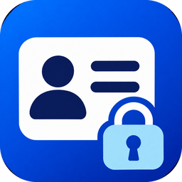

<p align="center">
  
</p>

<h1 align="center">Pocket Book</h1>

<p align="center">
  <b>A simple, offline password manager and contact book — install it and use it right away.</b><br>
  Windows · macOS · Linux — English · Français · Español · Deutsch · Italiano
</p>

<p align="center">
  <a href="../../releases/latest">Download</a> ·
  <a href="#install">Install</a> ·
  <a href="README.fr.md">Lire en français</a>
</p>

<p align="center">
  <a href="https://github.com/MortalHammer92/Pocket-Book/releases/latest/download/PocketBook-Setup-Windows.exe"></a>
  <a href="https://github.com/MortalHammer92/Pocket-Book/releases/latest/download/PocketBook-macOS-AppleSilicon.zip"></a>
  <a href="https://github.com/MortalHammer92/Pocket-Book/releases/latest/download/PocketBook-macOS-Intel.zip"></a>
  <a href="https://github.com/MortalHammer92/Pocket-Book/releases/latest/download/PocketBook-Linux.tar.gz"></a>
</p>

---

**Pocket Book** is a free, open-source **offline password manager** and **address book** for
**Windows, macOS and Linux**, designed for **seniors and beginners**: large text, big buttons,
no account, no cloud, no internet connection.

## Why

Many people keep their passwords and contacts in a pile of Word documents or text files.
Pocket Book was first made for an 80-year-old grandmother with **about 1,500 such documents**:
it reads them (without ever changing them), turns each one into a tidy card, and gives her
a calm, large-print window to find, copy and update what she needs.

It is deliberately **simple**:

- **No internet.** The program never connects to anything by itself (the only exception: the *Open* button
  next to a website opens it in your browser). Your data stays on your computer.
- **No account, no subscription, no master password to forget.**
- **Nothing to configure.** Download, double-click, *Install*.

> **Important — Pocket Book is not an encrypted vault.**
> Cards are stored as plain files in your *Documents* folder, readable by anyone who can open
> your user account. It is a tidier, safer replacement for "passwords in Word documents", not
> for an encrypted password vault like Bitwarden or KeePass. Protect your computer with a session
> password and, ideally, disk encryption (BitLocker, FileVault, LUKS).

## Features

- **Password cards** — name, username, email, password, website, notes, optional category.
  Copy buttons everywhere; the password is locked against accidental edits.
- **Contact cards** — mobile, landline, email, postal address, birthday, notes.
- **Add or remove fields** on any card (customer number, secret question…).
- **Password generator** — easy-to-read word passwords (in your language) or very strong ones.
  The old password is kept in the notes.
- **Import your documents** (`.docx`, `.txt`) — drag them onto the window or pick a folder.
  Pocket Book recognises passwords and contacts (in 5 languages), puts each piece of
  information in the right field, and **keeps the cards in sync** when a document changes.
  Your original documents are never modified.
- **Automatic saving**, a daily backup (30 kept) and automatic recovery if the file is damaged.
- **A readable `.txt` copy of every card**, updated automatically, in a folder of your choice.
- **Easy on the eyes** — 4 text sizes, 4 colour themes (light, dark, high contrast, soft sepia),
  A–Z letter bar, search, colour-coded categories.
- **5 languages** — detected automatically, changeable in *Settings*.

<!-- Screenshot: add docs/screenshot.png and uncomment
<p align="center"></p>
-->

## Who is it for?

- **Seniors and people who are not comfortable with computers** — everything is in large print,
  with plain words and confirmation before anything risky.
- **Families and caregivers** setting up a computer for a parent or grandparent.
- **Anyone with passwords scattered in Word or text files** who wants them tidy in minutes.

## Install

**Click the file for your computer** — it downloads directly, nothing else is needed (Python and
everything else are included). All versions: [latest release](../../releases/latest).

| System | File | How to install |
|---|---|---|
| **Windows** 10/11 (64-bit) | [**`PocketBook-Setup-Windows.exe`**](https://github.com/MortalHammer92/Pocket-Book/releases/latest/download/PocketBook-Setup-Windows.exe) | Double-click → **Install**. A *Pocket Book* icon appears on the Desktop and in the Start menu. |
| **macOS** (Apple Silicon) | [**`PocketBook-macOS-AppleSilicon.zip`**](https://github.com/MortalHammer92/Pocket-Book/releases/latest/download/PocketBook-macOS-AppleSilicon.zip) | Unzip, drag **Pocket Book** into *Applications*. |
| **macOS** (Intel) | [**`PocketBook-macOS-Intel.zip`**](https://github.com/MortalHammer92/Pocket-Book/releases/latest/download/PocketBook-macOS-Intel.zip) | Same as above. |
| **Linux** (Ubuntu 22.04+, Debian 12+, Fedora 36+…) | [**`PocketBook-Linux.tar.gz`**](https://github.com/MortalHammer92/Pocket-Book/releases/latest/download/PocketBook-Linux.tar.gz) | Extract, double-click `pocket-book` (or run `./pocket-book`) → **Install**. It is added to your applications menu. |

**First launch warnings.** The app is free and not signed with a paid certificate, so the
system warns you the first time:

- **Windows** — *"Windows protected your PC"*: click **More info → Run anyway**.
- **macOS** — *"Pocket Book cannot be opened"*: open **System Settings → Privacy & Security**,
  scroll down and click **Open Anyway** (only once).

**Uninstall** — Windows: *Settings → Apps → Pocket Book → Uninstall*. Linux: *Settings →
About → Uninstall…* inside the app. macOS: drag the app to the Bin.
Your cards are kept unless you tick *"Also delete all my cards"*.

## Your data

Everything lives in your **Documents/Pocket Book** folder:

| File | What it is |
|---|---|
| `pocketbook.json` | your cards and settings |
| `backups/` | one automatic copy per day (30 kept) + one before each import |
| `Cards as text/` | the readable `.txt` copy of every card (name depends on your language) |
| `index_documents.json` | a cache of the documents already read (safe to delete) |

To move to another computer, copy this folder.

## Run from source

Requires **Python 3.10+ with Tkinter** (included with the python.org installers;
on Linux: `sudo apt install python3-tk`). No other dependency.

```bash
git clone https://github.com/MortalHammer92/Pocket-Book.git
cd Pocket-Book
python3 pocket_book.py
```

Run the tests: `python -m pip install pytest && python -m pytest`

### Build the installers

- **Automatically** — push a version tag; GitHub Actions builds Windows, macOS and Linux and
  publishes a release:
  ```bash
  git tag v1.0.0 && git push origin v1.0.0
  ```
- **Locally** — `scripts\build_windows.bat` on Windows, `scripts/build.sh` on macOS/Linux.

## Project structure

```
pocket_book.py                 the whole application (logic + Tkinter interface + installer)
langues.py                     translations (EN, ES, DE, IT) and word lists for passwords
assets/                        icons
tests/                         pytest suite (recognition, saving, .txt copies, translations…)
scripts/verifier_traductions.py   reports missing or broken translations
scripts/build_windows.bat, build.sh   local builds
.github/workflows/             tests on 3 systems + release builds
```

The code is written in French (variables and comments); the interface is translated.
Adding a language means adding one dictionary in `langues.py` —
`python scripts/verifier_traductions.py` lists what is missing.

## FAQ

**Is Pocket Book free?** Yes, free and open source (MIT licence).

**Does it need an internet connection or an account?** No. It works fully offline and never
sends your data anywhere.

**Is it secure?** It keeps your data on your computer only, but it does **not encrypt** it.
Use it on a computer protected by a session password, ideally with disk encryption.

**Can it import my existing Word documents?** Yes: `.docx` and `.txt` files (not the old `.doc`
format). Passwords and contacts are recognised in English, French, Spanish, German and Italian.

**Which languages does the interface support?** English, French, Spanish, German and Italian.

## License

[MIT](LICENSE) — made by **Louis** ([@MortalHammer92](https://github.com/MortalHammer92)).
